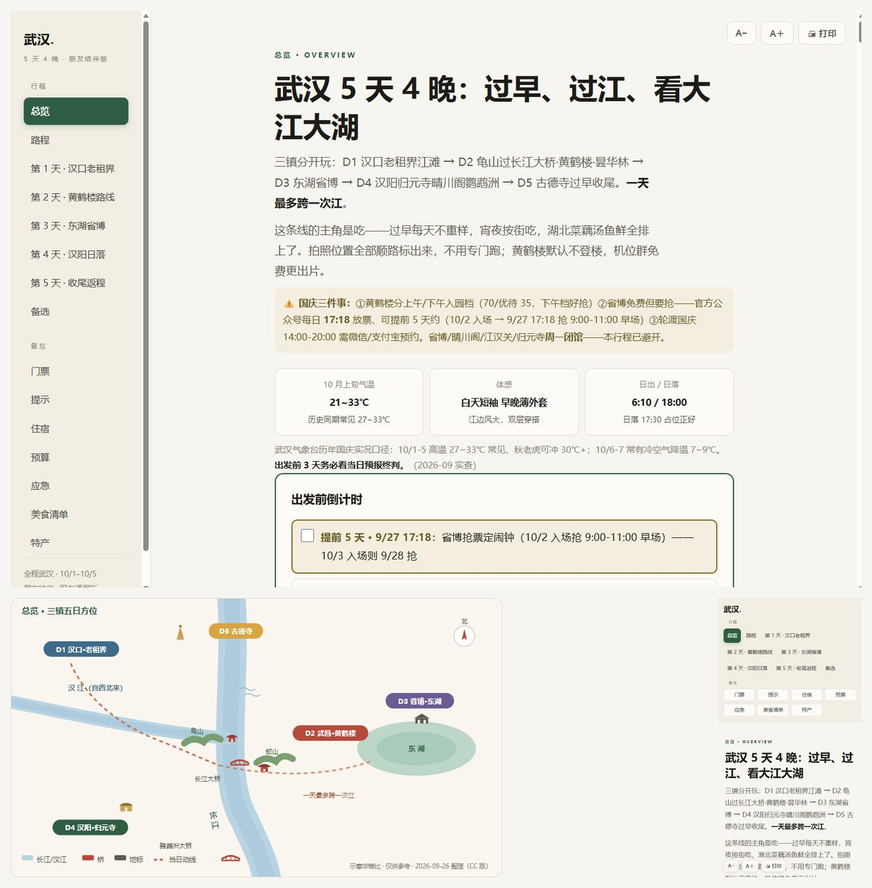
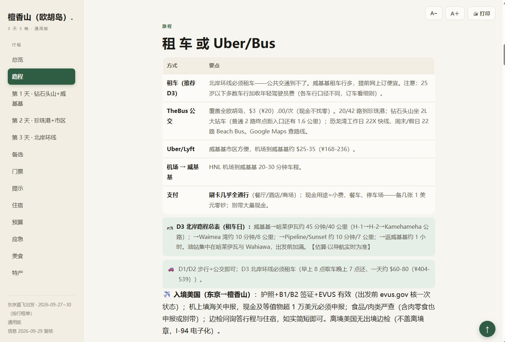
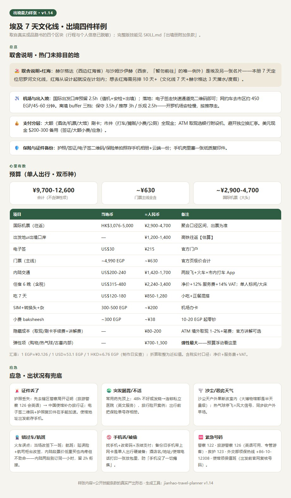

<div align="center">

# 见好 · 旅行路书

**让 AI 按统一流程查资料、排行程，制作可在手机和电脑查看的旅行路书。**

<sub>English: <a href="README.en.md">README.en.md</a> — what this is, what you get, and how to install it in any AI agent.</sub>

<p>
  <a href="https://github.com/awangwang123/jianhao-travel-planner/stargazers"></a>
  <a href="https://github.com/awangwang123/jianhao-travel-planner/releases"></a>
  <a href="LICENSE"></a>
  <a href="https://www.python.org/downloads/"></a>
  <a href="https://github.com/awangwang123/jianhao-travel-planner/actions/workflows/ci.yml"></a>
</p>

<sub><a href="#这是什么">📖 开始使用</a> · <a href="preview/hero.jpg">🖼 看成品示例</a> · <a href="https://github.com/awangwang123/jianhao-travel-planner/releases">⬇️ 下载稳定版</a> · <a href="https://github.com/awangwang123/jianhao-travel-planner/issues">❓ 遇到问题</a> · <a href="TUTORIAL.md">零基础教程</a></sub>



<sub>开源技能包，需配合 AI 助手使用 · 统一模板 · 事实核查流程 · 机械检查工具 · MIT</sub>

</div>

---

## 这是什么

一套「出行路书」工作流：你说"想出去玩"，它按固定流程采集需求 → 联网实查 → 产出**路书**（md 事实源 + 单文件 HTML 双版本：本地完整版断网可开 + 瘦身在线版一键部署）+ **美食情报卡**（按城市持续追加的数据资产）。

> [!TIP]
> **SKILL.md 的版本史是精华**——每条规矩背后都是一次真实翻车（图注落位对 ≠ 图内容对、数指标不算对比、价钱是挂牌价不是实付价……），建议通读，比规矩本身更值钱。

## 你能得到什么

- 📄 **单文件路书**：本地完整版断网可开，手机、电脑、打印纸都好看
- 🌐 **一键部署在线版**（需自有服务器，可选）：瘦身网页版一键部署，点开链接即看
- 🔍 **信息可信**：关键信息联网实查带来源，出发前按当日预报终判
- 🖼 **每天有实拍图**：真实景点照片 + 手绘行程导览图，不堆网图
- 🍜 **吃饭有章法**：推荐店各归各位，照抄照选两相宜
- 🚫 **隐私干净**：对外内容零敏感残留
- 🍱 **美食情报卡**：按城市持续追加的数据资产，越用越厚
- ✅ **交付可验收**：内置 `tools/checklist.py` 机械检查清单（随版本演进，以工具输出为准），AI 交稿前必跑——你也能一键验收 AI 有没有偷懒。注意：机械检查通过 ≠ 关键事实（交通/票务/价格）已核验，出行前请按路书内的核实状态标注复核

## 一份路书里有什么

| 板块 | 内容 |
|------|------|
| 总览 | 一句话行程 + 天气 + 出发前倒计时（勾选式）+ 装备清单 + 总览导览图 |
| 路程 | 交通方式怎么选 + 路程总表（里程/时长）+ 支付提示 |
| 每日行程 | 半小时级时段卡 + 实拍图 + 当日导览图 + 交通/机位/雨天方案 |
| 门票预约 | 多档价格 + 预约与放票口径 |
| 温馨提示 | 真实场景 + 应对，不写正确的废话 |
| 住宿 | 选点逻辑 + 退房时间 + 订房三问 |
| 预算 | 三档概览 + 逐项明细 + 隐藏成本 |
| 应急 | 全局兜底 + 紧急电话与领事保护 |
| 美食清单 | 按天按顿给店 + 必点 + 人均 |
| 特产 | 带什么 + 在哪买 |

## 换个目的地，形态自动适配



<sub>海岛型目的地的路程板块——租车 / 公交 / 打车分层给方案，行程要素按目的地自动换挡</sub>

## 出境路书，同一套标准（v1.14 出境能力包）



<sub>埃及 7 天文化线·出境四件样张：热门未排目的地的取舍说明 / 出入境与支付分层 / 双币种预算（含税实付口径）/ 应急领保——行程与个人信息已脱敏，完整条款见 SKILL.md「出境册附加条款」</sub>

## 触发词

安装后，跟 AI 说这些话会自动触发本 Skill：

> 去哪玩 / 旅行攻略 / 周末去哪 / 做攻略 / 行程规划 / 自驾方案 / 当日行程 / 今天去哪 / 特产推荐

## 安装（2 分钟）

> 🐣 **完全没接触过 Claude Code？** 直接看 **[零基础跑通指南 TUTORIAL.md](TUTORIAL.md)**——从装 AI 助手到拿到第一份路书，每一步带自检。

解压后你会得到一个 `jianhao-travel-planner` 文件夹（别改名），把它整个放进 skills 目录：

- **全局**（推荐）：`~/.claude/skills/`（Windows 即 `C:\Users\<用户名>\.claude\skills\`）
- **单项目**：`<项目>\.claude\skills\`
- **可选：启用 pre-push 白名单闸门**（防止白名单外文件被误推上仓）：在仓目录执行 `git config core.hooksPath tools/githooks`——之后任何 push 前自动核对文件清单，白名单外会被硬拦截。

装好后的路径应该是 `…/skills/jianhao-travel-planner/SKILL.md`。放对之后，跟 AI 说"周末想去 XX 玩"就会被自动触发。

### 不用 Claude Code？任意 AI 助手都能用

这个技能包本质是**一个文件夹 + 一份工作流文档**，不绑定任何特定 AI。其他 AI 助手（任何能读文件、能联网的 Agent 环境）通用安装法：

1. 把 `jianhao-travel-planner` 文件夹原样放进 AI 的工作区（或直接把文件夹拖给它）
2. 对 AI 说：

> 「这是一个旅行规划技能包。**先完整阅读 SKILL.md 全文再动手**，**禁止把它改写成摘要或精简入口文件**——工作流全文就是执行正文。然后按阶段 0 先向我提问（出发地/日期/人数与关系），确认需求后再开始。」

3. `assets/`（基准骨架）和 `tools/`（检查脚本）保持原目录结构，AI 制作路书时会用到

> ⚠️ **为什么不许摘要改写**：实测有 AI 环境把 93KB 工作流正文塞进附录、自写了个摘要入口——阶段 0 提问条款、交付自查清单全被埋掉，做出的路书出发地默认错误、零提问直接开工。全文在，条款才在。

> 💡 **如果 AI 没问你就开始做路书**，把这句发给它：「按 SKILL.md 阶段 0 先向我提问（出发地/日期/人数与关系），确认后动工——你的开工前置闸漏执行了。」

> 📝 **需求一次说全**体验最好：出发地 + 日期窗口 + 几个人什么关系 + 有无特殊成员。说"我要去山东玩 5 天"它也会追问，但一次说全省一轮。

目录结构（缺一不可）：

```
jianhao-travel-planner/
├── SKILL.md          ← 工作流正本
├── assets/           ← 路书+情报卡两份 HTML 基准骨架
└── tools/            ← consistency.py（骨架校验）+ desource.py（脱敏）
```

> ⚠️ **已有同名包？** 如果 skills 目录里已存在 `jianhao-travel-planner` 文件夹，本包拷入会覆盖它（作者的自用版叫 `travel-planner`，不同名、不受影响）。

## 配图（图源与 API key 可选，成品每日配图是硬要求）

路书要求"每天都有图"——**不配图过不了交付自查清单第⑱项**；但**配图渠道完全可选**，任选其一即可满足：

1. **Wikimedia Commons**（默认图源，免费免 key）：按「地标名」精准检索实拍照片，挑近期真实照片用；若在你的网络环境不可达，skill 自动改用下一级图源，不影响出图
2. **Pexels**（免费可商用，需注册 API key）：key 存本机 `.env`（`PEXELS_API_KEY=你的key`）或环境变量，适合氛围空镜——**key 只是图源之一的选择项，没有它走默认图源即可**
3. **AI 生图**：用自己的生图工具产「（示意）」图——页脚注明「AI 生成示意」即可

非实拍图标注「（示意）」、页脚写明来源即可。

## 稳定版下载

不想折腾安装？[Releases 页](https://github.com/awangwang123/jianhao-travel-planner/releases)提供打包好的稳定版 zip（含技能规范与全部工具）；主分支为最新开发态，两者可能不同步——**使用以 Releases 为准**。

## 工具模式（不装 skill，直接用生成工具链）

v1.17 起随包提供完整生成工具链——不想让 AI 走整套技能流程的话，也可以按 `schema.md` 填写 `trip_data.json`（可交给任意 AI 按 schema 代填）。**推荐用随包统一入口一条链跑完**（数据校验 → 生成 → 导览图注入 → 最终成品检查，自动按序执行并计时）；带 `--visual` 连视觉验收（桌面/手机双视口 + 图渲染逐张确认）一起跑：

```bash
py tools/pipeline.py full fixtures/demo/demo_full.json 我的示范册.html --visual
```

也可分步执行（**顺序重要——导览图注入后必须再做最终成品检查**）：

```bash
py tools/validate_trip_data.py 你的trip_data.json      # ① 数据闸（V01-V22：引用/枚举/日期对齐/费用三态/时刻单源等）
py tools/gen_roadbook.py 你的trip_data.json 路书.html   # ② 生成（骨架指纹校验，天数自适应）
py tools/apply_routes.py 你的trip_data.json 路书.html   # ③ 导览图注入（有 routes 时执行；无 routes 自动跳过）
py tools/checklist.py 路书.html --visual               # ④ 最终成品检查（注入后的最终页面，FAIL 清零才交付）
```

### 样本分工（三类，别混用）

| 样本 | 用途 | 成品检查预期 |
|---|---|---|
| `fixtures/demo/demo_full.json` | **完整示范：第一次跑通用它**——虚构 3 天册，含导览图、7 张虚构示意配图与全部板块 | 四步（含 `--visual`）跑完 **FAIL 0**，7/7 配图真渲染 |
| `fixtures/synth/book3/8/10.json` | 最小合成样本：**只用于测试链路**（内容空壳/配图不足属预期） | 内容类 FAIL 属预期，非上手示范 |
| `fixtures/good_full.json` | 校验演示：演示数据规则（不可渲染生成） | 仅数据闸 |
| `fixtures/synth_abroad_sample.json` | 出境格式样本（跨日红眼/时区/双币种） | 配合 test_abroad 使用 |
- 回归测试（合成数据，不含真实目的地信息）：`py tools/test_synth_regression.py`；出境格式：`py tools/test_abroad.py`
- 出境样本：`fixtures/synth_abroad_sample.json`（跨日红眼/时区/双币种）
- 依赖：仅 Python 3.8+ 标准库；`checklist.py --visual` 的视觉检查可选装 Playwright（缺失自动 SKIP 声明）

## 第一次使用前

打开 `SKILL.md` 末尾的「用户档案（填空模板）」，复制填写你自己的偏好（出发地/口味/作息/同行者常态），填完这套 skill 就"认识"你了。信源名单不用预置——它会用大众点评+高德+小红书交叉验证，你在旅途中刷到靠谱探店内容可以补进自己的名单。

## 不需要的东西

- 任何平台登录态（抖音/小红书/B站都不需要）
- 付费 API
- 博主白名单（原个人设定已移除）

## 看完整成品

<details>
<summary><b>展开看武汉 5 天 4 晚完整路书（长图，约 2MB）</b></summary>


</details>

## 上线反响


<sub>开源次日的抖音介绍视频：12.6 万播放 · 2889 收藏（数据截至 2026-09-30）</sub>


## 版本

当前 **v1.19**（2026-11-03）。最近两版要点：

- **v1.19**：新增「中转衔接与廉价航空」条款与知识蒸馏核查规则（转述 ≠ 核查）；最小流程改造——`QUICKSTART.md` 一页纸入口、标准模板、`pipeline new/outline`、`fetch_images`
- **v1.18**：完整示范配图改为标注「虚构示意」的插画；导览图出界检查收成三态（越界 FAIL / 查不完 FAIL / 无图 SKIP）；已发布标签不再覆盖

v1.0 起的逐版记录在 [CHANGELOG.md](CHANGELOG.md)。稳定包以 [Releases](https://github.com/awangwang123/jianhao-travel-planner/releases) 为准，主分支是开发态。

## 反馈与共创

- 🐛 **报错/用不了**：[Issues](https://github.com/awangwang123/jianhao-travel-planner/issues) 发帖（有模板）
- 📍 **许愿城市**：[旅行许愿池](https://github.com/awangwang123/jianhao-travel-planner/discussions/1)——点赞最高的城市，下一份官方示例就是它（附完整生成过程记录）
- 💬 其他想法：[Discussions](https://github.com/awangwang123/jianhao-travel-planner/discussions) 随便聊
- 🛠 **参与改进**：看 [CONTRIBUTING.md](CONTRIBUTING.md)（怎么报错、许愿、提 PR）
